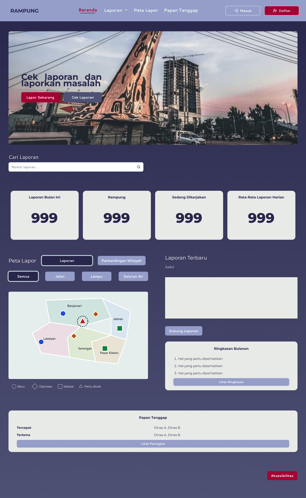
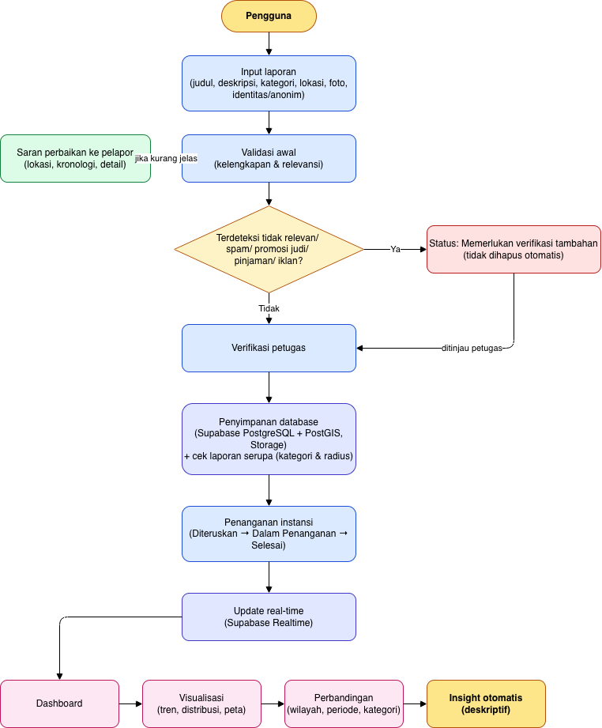
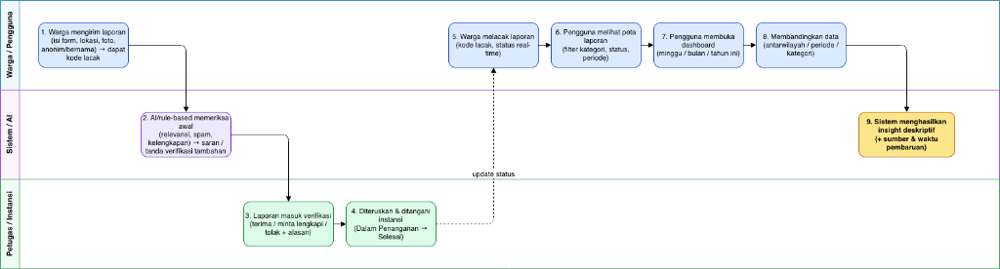
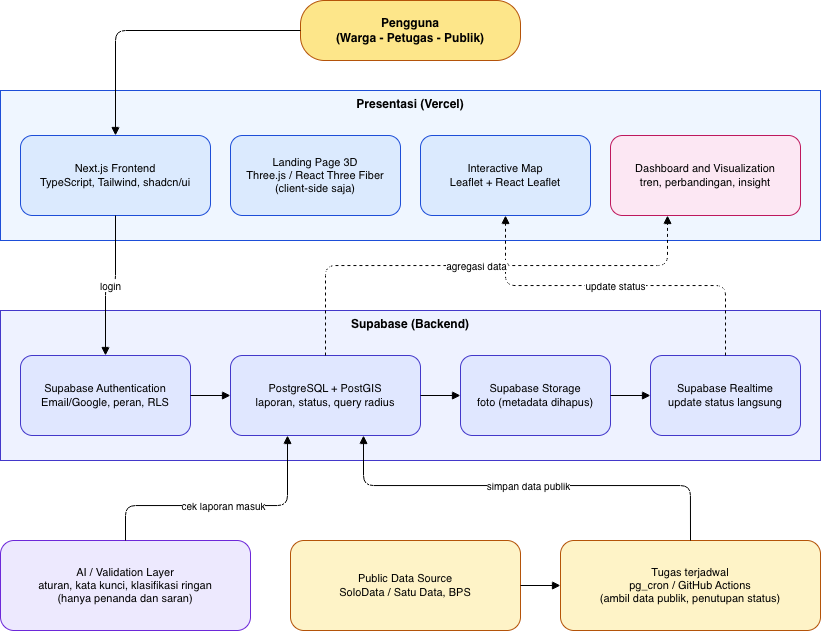

# RAMPUNG (Ruang Aduan, Monitor Penanganan, Ungkap Nyata Guyub)

Karya Kompetisi Web In Action (WIA) - Multimedia In Action (MIA) 2026  
Tim: OTW jdi nasabah prioritas (Institut Teknologi Sepuluh Nopember)
- Revalina Erica Permatasari (Project Manager & UI/UX Designer)
- Syifa Nurul Alfiah (Frontend Engineer)
- Putri Joselina Silitonga (Backend Engineer)

---

## 1. Deskripsi Project

RAMPUNG adalah platform web pelaporan keluhan warga dan analisis data publik berbasis transparansi dua arah, yang mengintegrasikan verifikasi bukti foto sebelum-sesudah (*before-after*) dengan dasbor wawasan kewargaan (*civic insight*) untuk mendukung akuntabilitas layanan publik Kota Surakarta. Melalui integrasi pelaporan partisipatif dan pemetaan geospasial, platform ini memastikan setiap aduan tertangani secara nyata dan hasilnya dapat diverifikasi langsung oleh masyarakat.

Pelapor menjadi penentu akhir apakah suatu laporan benar-benar *rampung*. Platform ini ditujukan bagi warga Kota Surakarta (5 kecamatan, 54 kelurahan, 587.646 jiwa; Dispendukcapil Kota Surakarta, 2023), petugas instansi, dan publik yang ingin memantau kinerja layanan.



### Masalah yang Diselesaikan

| Masalah | Solusi di RAMPUNG |
| :--- | :--- |
| Laporan sulit dipantau | **Lacak Laporan**: garis waktu status dan hitungan hari dengan kode lacak |
| Klaim "selesai" sulit dicek | Foto sebelum-sesudah berdampingan; pelapor menjawab "Sudah beres" atau "Belum" |
| Data sulit dipahami | **Papan Tanggap**, **Ringkasan Bulanan**, dan "Dari Mana Data Ini?" untuk tiap angka |
| Layanan belum inklusif | Teks besar, kontras tinggi, fitur dibacakan, dan navigasi keyboard (target WCAG 2.2 AA) |

### Fitur Utama

- **Lapor Cepat**: pilih kategori lewat ikon (Jalan, Lampu, Saluran Air), foto "sebelum", lokasi terisi otomatis, bisa anonim atau bernama, lalu mendapat kode lacak.
- **Lacak Laporan**: masukkan kode atau lihat riwayat akun; linimasa status diperbarui secara real-time.
- **Peta Laporan**: sebaran laporan per wilayah dengan filter kategori, status, dan periode; status dibedakan lewat warna dan bentuk (Baru, Diproses, Selesai, Perlu dicek).
- **Laporan Serupa**: sistem menampilkan laporan di sekitar lokasi dengan kategori sama sehingga warga bisa mendukungnya tanpa membuat laporan ganda.
- **Panel Petugas**: antrean verifikasi, penanda "perlu verifikasi tambahan", dan pembaruan status penanganan.
- **Dashboard (Civic Insight)**: tren, distribusi, perbandingan antarwilayah, periode, dan kategori, disertai insight otomatis yang bersifat deskriptif.
- **Tentang & Sumber Data**: metodologi, sumber dan waktu pembaruan data, serta kebijakan privasi.

---

## 2. Alur Aplikasi

Aplikasi melibatkan tiga peran: **Warga/Pengguna**, **Sistem (validasi)**, dan **Petugas/Instansi**.

1. **Warga membuat laporan.** Dari beranda, warga memilih *Lapor Sekarang*, mengisi judul, deskripsi, kategori, lokasi, foto sebelum, dan identitas (anonim atau bernama). Setelah terkirim, warga menerima **kode lacak**.
2. **Sistem memeriksa laporan awal.** Sistem mengecek kelengkapan dan relevansi. Jika kurang jelas, warga mendapat **saran perbaikan** (lokasi, kronologi, detail). Jika terdeteksi spam, promosi, pinjaman, atau iklan, laporan diberi status **"Memerlukan verifikasi tambahan"**. Laporan tidak dihapus otomatis.
3. **Petugas memverifikasi.** Petugas menerima laporan, meminta dilengkapi, atau menolak disertai alasan. Laporan yang ditandai sistem ditinjau oleh petugas.
4. **Laporan disimpan dan dicek kemiripannya.** Data masuk ke database (Supabase PostgreSQL + PostGIS) dan foto ke Storage. Sistem mencari laporan serupa berdasarkan kategori dan radius lokasi.
5. **Instansi menangani.** Status berjalan: **Diteruskan → Dalam Penanganan → Selesai**, dan petugas mengunggah foto sesudah.
6. **Warga melacak secara real-time.** Perubahan status tampil langsung lewat Supabase Realtime pada halaman *Lacak Laporan*.
7. **Warga mengonfirmasi hasil.** Warga melihat foto sebelum dan sesudah berdampingan lalu menjawab "Sudah beres" atau "Belum".
8. **Warga dan publik memantau.** *Peta Laporan* menampilkan sebaran laporan dengan filter; *Dashboard* menampilkan tren, perbandingan, dan insight otomatis lengkap dengan sumber serta waktu pembaruan data.

### Catatan tentang Validasi Laporan

Lapisan validasi bekerja dengan aturan dan kata kunci (*rule-based*) serta klasifikasi ringan. Fungsinya hanya **memberi penanda dan saran**, bukan menolak laporan. Sistem tidak dapat memastikan benar atau tidaknya suatu kejadian di lapangan; keputusan akhir ada pada petugas, dan hasil perbaikan dikonfirmasi oleh pelapor.

### Diagram Alur dan Arsitektur Sistem

#### Flowchart Sistem


#### User Flow


#### Arsitektur Sistem


---

## 3. Tech Stack yang Digunakan

| Komponen | Teknologi | Keterangan |
| :--- | :--- | :--- |
| Framework Utama | Next.js 14 (App Router) | Server-side rendering dan routing aplikasi terpadu |
| Bahasa Pemrograman | TypeScript | Keamanan tipe data statis (type safety) |
| Desain & Styling | Tailwind CSS | Utility-first CSS framework |
| Komponen Antarmuka | shadcn/ui (Radix UI) | Komponen aksesibel berstandar WCAG |
| Visualisasi 3D | Three.js / React Three Fiber | Elemen visual 3D interaktif pada beranda (client-side) |
| Peta Interaktif | Leaflet & React-Leaflet | Pemetaan titik sebaran laporan geospasial |
| Backend & Basis Data | Supabase (PostgreSQL) | Basis data relasional dan otentikasi (Row Level Security) |
| Ekstensi Geospasial | PostGIS | Kueri jarak radius untuk deteksi laporan serupa di sekitar lokasi |
| Penyimpanan Media | Supabase Storage | Penyimpanan foto kondisi sebelum dan sesudah (sanitasi metadata EXIF) |
| Pembaruan Real-Time | Supabase Realtime | Distribusi pembaruan status tiket penanganan secara langsung |
| Validasi Konten | Rule-Based Text Sanitizer | Deteksi dini spam, promosi, dan konten tidak relevan |
| Deployment & Hosting | Vercel | Platform hosting frontend teroptimasi |

---

## 4. Cara Menjalankan Project

### Prasyarat
- Node.js versi 18.17.0 atau lebih baru
- Package manager (npm, pnpm, atau yarn)
- Git

### Langkah Instalasi dan Menjalankan

1. **Clone Repository**
   ```bash
   git clone https://github.com/revaerica/WIA-OTW-jdi-nasabah-prioritas.git
   cd WIA-OTW-jdi-nasabah-prioritas
   ```

2. **Install Dependencies**
   ```bash
   npm install
   ```

3. **Hubungkan Supabase**
   - Buat project di Supabase.
   - Dari **Project Settings → API**, salin Project URL dan `anon`/publishable key.
   - Salin template lalu isi `.env.local` (jangan commit file ini):
     ```powershell
     Copy-Item .env.example .env.local
     ```
   - Isi nilai berikut:
     ```env
     NEXT_PUBLIC_APP_URL=http://localhost:3000
     NEXT_PUBLIC_SUPABASE_URL=https://<project-ref>.supabase.co
     NEXT_PUBLIC_SUPABASE_ANON_KEY=<anon-or-publishable-key>
     SUPABASE_SERVICE_ROLE_KEY=<service-role-secret>
     ```
   - Ambil `SUPABASE_SERVICE_ROLE_KEY` dari pengaturan API/secret keys. Kunci ini hanya untuk server; jangan pernah menambahkan awalan `NEXT_PUBLIC_` atau mengirimkannya ke orang lain.

4. **Buat skema database**
   - Di Supabase, buka **SQL Editor**.
   - Untuk project Supabase yang akan dipakai sungguhan, jalankan migrasi `001` sampai `015` secara berurutan. Jangan jalankan `016_seed_laporan_simulasi.sql` pada database live; file itu hanya untuk project demo terpisah. Detailnya ada di [supabase/README.md](./supabase/README.md).
   - Pastikan tabel kategori terisi dengan menjalankan `SELECT id, nama, slug FROM public.kategori;`.
   - Untuk fitur foto, buat bucket Storage privat bernama `laporan-foto`.

5. **Jalankan aplikasi**
   ```bash
   npm run dev
   ```
   Buka `http://localhost:3000`. Jika mengubah `.env.local`, hentikan lalu jalankan ulang server agar konfigurasi terbaca.

   - Untuk kerja FE tanpa Supabase, biarkan `NEXT_PUBLIC_USE_MOCK=true`. Halaman memakai berkas data lokal; laporan baru pada mode ini tersimpan di browser yang digunakan.
   - Untuk menguji koneksi database, isi tiga variabel Supabase dengan nilai project milik tim dan set `NEXT_PUBLIC_USE_MOCK=false`.
   - Pendaftaran dan login memakai Supabase Auth. Trigger migrasi `005_tabel_pengguna.sql` membuat profil dengan role `warga`; role `petugas` dan `admin` hanya dapat diberikan administrator, bukan dipilih lewat pendaftaran publik.
   - Tanpa konfigurasi Supabase, pendaftaran/login menampilkan error dan tidak membuat akun lokal palsu. Unggah foto belum tersambung end-to-end ke Supabase Storage.

6. **Build Produksi**
   ```bash
   npm run build
   npm run start
   ```

---

## 5. Progress Saat Ini

Pada tahap **First Draft Submission (01 November 2026)**, progres tim saat ini berfokus pada **tahap pembuatan UI/UX, arsitektur informasi, wireframing, dan interactive prototype di Figma**, sembari menyiapkan fondasi arsitektur kode dan basis data:

| Modul / Komponen | Rincian Pekerjaan | Status Saat Ini |
| :--- | :--- | :--- |
| Perancangan UI/UX (Figma) | Perancangan alur interaksi, wireframe layar utama, design system, dan prototype interaktif di Figma. | Sedang Berjalan (Fokus Utama) |
| Perancangan Sistem & Data | Penyusunan flowchart alur sistem, user flow swimlane, arsitektur sistem, dan skema PostGIS. | Selesai |
| Inisialisasi Repositori | Setup proyek Next.js 14 App Router, konfigurasi TypeScript, Tailwind CSS, dan dokumentasi teknis. | Selesai |
| Implementasi Antarmuka Web | Halaman publik, form pelaporan, pelacakan, dan peta tersedia; beberapa panel petugas masih perlu dihubungkan ke data operasional. | Berjalan |
| Integrasi Backend & Basis Data | Login/daftar Supabase Auth, profil, dan alur role sudah tersambung. Uji end-to-end masih diperlukan; unggah foto, notifikasi real-time, serta beberapa modul operasional masih perlu dilengkapi. | Fondasi tersedia; integrasi belum lengkap |

---

## 6. Struktur Dokumentasi

```
WIA-OTW-jdi-nasabah-prioritas/
├── README.md
└── docs/
    ├── WIA_FSDMIA2026_OTW-jdi-nasabah-prioritas.pdf   (PDF First Draft yang dikumpulkan)
    └── images/
        ├── Desktop.png              (preview landing page)
        ├── flowchart-sistem.png
        ├── user-flow.png
        └── arsitektur-sistem.png
```
